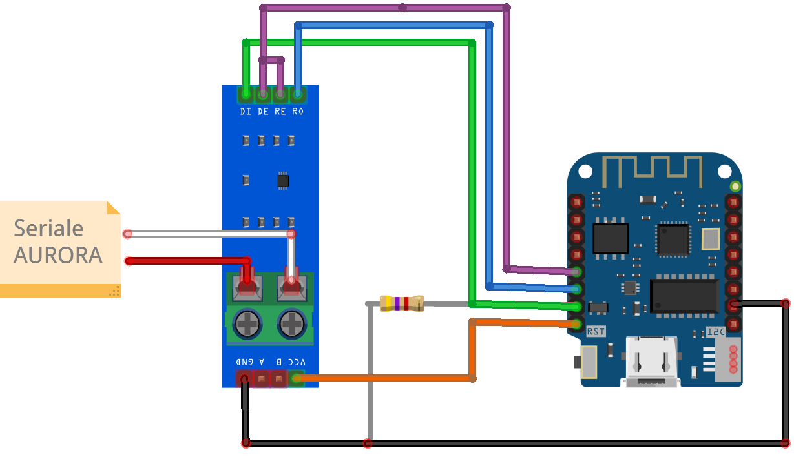
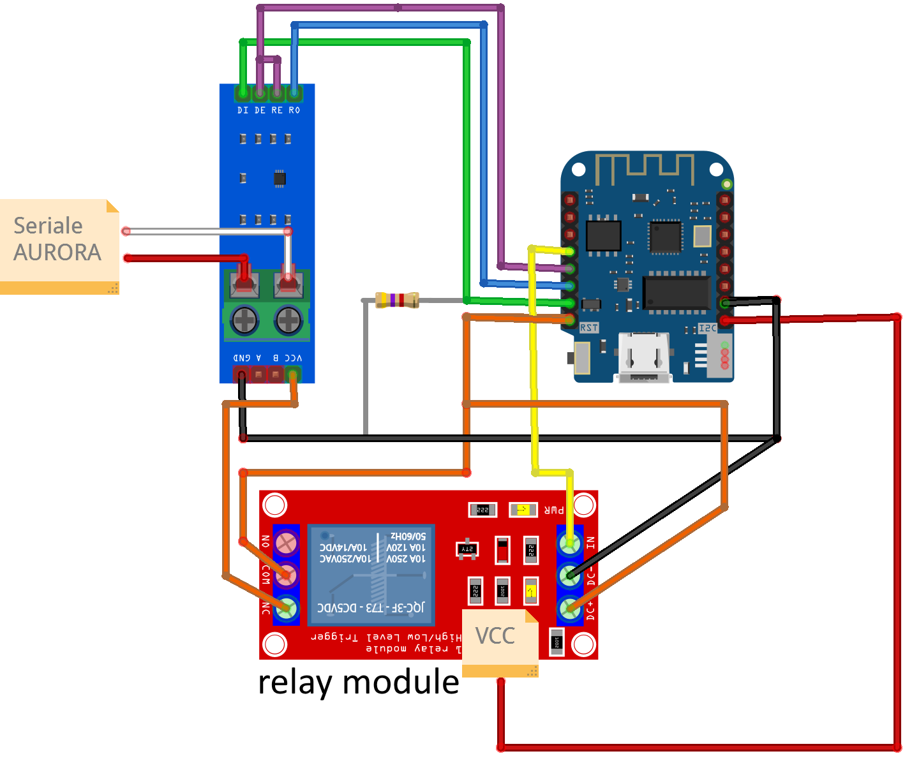

# ESPHome Aurora Monitor

An [ESPHome](https://esphome.io/) external component that reads data from one or more **Power-One / ABB Aurora solar inverters** over a shared **RS485** bus and exposes it to [Home Assistant](https://www.home-assistant.io/).

A single ESP8266 (or ESP32) board with a TTL-to-RS485 transceiver polls the inverters in turn, using the Aurora communication protocol, and publishes voltages, currents, power, temperatures and energy counters as native ESPHome sensors to be used on Home Assistant.

## Features

- Monitors any number of Aurora inverters on the same RS485 bus, each with its own RS485 address and entity name prefix
- Sensors created automatically, with the option to exclude or customise any of them
- Device and state classes on every sensor, ready for the Home Assistant Energy dashboard
- 22 sensors per inverter: DC input voltage/current/power for both strings, total input power, AC grid power/voltage/current/frequency, conversion efficiency, daily and all-time power peaks, inverter and booster temperatures, energy produced today / this week / this month / this year / in total
- Text sensors per inverter for the connection status, the inverter state and its alarm, plus an alarm history
- Diagnostic entities with the inverter model, part and serial number, firmware, manufacturing date and clock offset, plus isolation resistance and leakage currents
- Only the values that are used are requested from the inverter, keeping each polling cycle short
- Automatic reinitialisation of the serial port if an inverter stops responding
- Energy counters and power peaks are saved to flash when an inverter switches off and restored after a reboot
- An optional reset button that pulses a GPIO to reset a jammed RS485 adapter (for example by power-cycling it through a transistor or relay)

## Hardware

- An ESP8266 board (I tested only on a Wemos D1 mini) or an ESP32
- A TTL-to-RS485 transceiver module (MAX485 or similar) with a driver-enable input; the tested setup uses [this module](https://www.aliexpress.com/item/1005001621798947.html)
- The RS485 port of each inverter, wired in parallel on the same A/B pair

### Wiring ESP8266

This is the tested setup: a Wemos D1 mini and a MAX485 module powered at 3.3 V by the D1 mini, with a 4.7 kΩ pull-down resistor on GPIO15 [D8] (see the notes below). I monitor two inverters connected in parallel to the A and B terminals of the module.



On the ESP8266 the component uses the hardware `UART0`, by default on its alternate (swapped) pins, so the USB serial port stays free. In this configuration serial logging must be disabled (see the example configuration).

| ESP8266 pin     | D1 mini | Connects to                                   | Option                       |
|-----------------|---------|-----------------------------------------------|------------------------------|
| GPIO13 (RX)     | D7      | RS485 module `RO`                             | `rx_pin` (13 or 3)           |
| GPIO15 (TX)     | D8      | RS485 module `DI`                             | `tx_pin` (15 or 1)           |
| GPIO12          | D6      | RS485 module `DE` + `RE` (direction control)  | `gpio_tx_control_pin`        |
| GPIO2           | D4      | On-board LED, used as activity LED            | `activity_led_pin`           |
| GPIO14          | D5      | Optional reset relay, see [below](#resetting-the-rs485-adapter) | `gpio_reset_pin`             |


`UART0` can only use GPIO13/GPIO15 (swapped) or GPIO3/GPIO1 (its default pins, not recommended because shared with the USB adapter).

The serial link runs at 19200 baud, 8N1, as required by the Aurora protocol.

#### Wiring notes

- **GPIO15 must be low at boot.** It is a strapping pin: if it is high when the ESP8266 starts, the board does not boot. The D1 mini has a 10 kΩ pull-down on it, but many cheap MAX485 modules have 10 kΩ pull-ups on their inputs, DI included, which fight against it. The tested setup adds a 4.7 kΩ pull-down between D8 and GND; removing the pull-up of the module on DI should also work, but it is not recommended.
- **Logic levels.** The ESP8266 works at 3.3 V. In the tested setup the MAX485 module is powered at 3.3 V by the D1 mini. A MAX485 powered at 5 V drives RO at 5 V: in that case use a 3.3 V transceiver such as the MAX3485, or add a voltage divider between RO and GPIO13.
- **RS485 bus.** Connect A to A and B to B on every device. On long lines, enable the 120 Ω termination on the last inverter of the chain to avoid reflections: on Aurora inverters it is a switch on the communication board (often labelled S2, "120 Ω TERM", off by default; check the manual of your model). Many MAX485 modules already have a 120 Ω resistor on board, which terminates the other end of the line.

### Wiring ESP32 (not tested)

On ESP32 the component uses `UART2` (`Serial2`), by default on RX = GPIO14 and TX = GPIO27, with `DE`/`RE` on GPIO26; all of them can be changed. Avoid GPIO12 for `DE`/`RE`: it is a strapping pin that selects the flash voltage at boot. The component uses the Arduino serial API, so it needs the Arduino framework:

```yaml
esp32:
  board: esp32dev
  framework:
    type: arduino
```

### Inverter addresses

Every Aurora inverter answers on an RS485 address that can be changed from the inverter's display menu (the factory default is `2`). Since the inverters share the bus, each one must have a different address, for example `2` and `3`.

## Installation

### From GitHub

You can download only the [esphome-auroramonitor.yaml](esphome-auroramonitor.yaml) file, it references the component directly from this repository, with this setting:

```yaml
external_components:
  - source: github://wergio/esphome-auroramonitor
    components: [aurora_monitor]
```

### Local copy

To compile from a local copy, copy the `components/aurora_monitor` folder of this repository into a `components` folder next to your YAML file (on Home Assistant, `/config/esphome/components`), and use:

```yaml
external_components:
  - source:
      type: local
      path: components
```

## Configuration

A complete example is in [esphome-auroramonitor.yaml](esphome-auroramonitor.yaml); it reads `wifi_ssid`, `wifi_password` and `auroramonitor_api_key` from your `secrets.yaml`. A minimal configuration:

```yaml
logger:
  baud_rate: 0          # keep the logger off UART0 on ESP8266

time:
  - platform: homeassistant
    id: ha_time

aurora_monitor:
  time_id: ha_time
  inverters:
    - address: 2
```

This creates every sensor listed below, named `v_in_1`, `v_in_2`, and so on. `baud_rate: 0` is needed only on ESP8266, and `time_id` is required: the component needs the local time for the period resets described below, to restore the saved values after a reboot and for `clock_offset`.

### Inverters

Each entry of `inverters` describes one inverter on the bus:

| Option     | Default | Description                                                                 |
|------------|---------|-----------------------------------------------------------------------------|
| `address`  | `2`     | RS485 address of the inverter                                               |
| `mppt_inputs` | `2`  | Number of MPPT inputs of the inverter (`1` or `2`), see below                |
| `prefix`   | —       | Prefix of the entity names (`<prefix>_<sensor>`); required with more than one inverter |
| `exclude`  | —       | List of sensors not to create                                               |
| `sensors`  | —       | Per-sensor options (`name`, `filters`, `unit_of_measurement`, ...), keyed by sensor |

A single inverter needs no prefix: its entities are simply named `v_in_1`, `cumulated_energy_total`, and so on. With 2 inverters the entities are, based on the prefixes, `inverter1_v_in_1`, `inverter1_cumulated_energy_total`, `inverter2_v_in_1`, `inverter2_cumulated_energy_total`, and so on.

The Aurora protocol reports at most two DC inputs (MPPT channels). For an inverter with a single MPPT input, set `mppt_inputs: 1`: the sensors of the second input (`v_in_2`, `i_in_2`, `power_in_2`) are not created nor requested, and `power_in_total` and `efficiency` use the first input only. Set it also when the second input has no string connected: its voltage of 0 V would be discarded (see below), so `v_in_2` would stay *unknown*.

Example of optional parameters:

```yaml
aurora_monitor:
  inverters:
    - address: 2
      mppt_inputs: 1
      exclude: [temp_booster]
      sensors:
        cumulated_energy_total:
          name: "Total energy"
          filters:
            - multiply: 0.001
          unit_of_measurement: kWh
```

Each inverter adds up to 20 requests to every polling cycle; with many inverters, check that a cycle fits in `update_interval`, see below (the log warns when a cycle is still running at the next update).

### Options

| Option                | Default | Description                                         |
|-----------------------|---------|-----------------------------------------------------|
| `inverters`           | —       | The inverters on the bus, see above (required)      |
| `rx_pin`, `tx_pin`    | `13`, `15` (ESP8266), `14`, `27` (ESP32) | UART pins of the RS485 module |
| `gpio_tx_control_pin` | `12` (ESP8266), `26` (ESP32) | GPIO driving the `DE`/`RE` pins of the RS485 module |
| `gpio_reset_pin`      | —       | GPIO of an optional RS485 adapter reset circuit; adds the reset button, see below |
| `time_id`             | —       | ESPHome time component (required): used for the period resets, the restore after a reboot and `clock_offset` |
| `activity_led`        | `true`  | Enable activity LED                               |
| `activity_led_pin`    | GPIO2, inverted (active low) by default on ESP8266   | Custom LED pin  |
| `tx_enable_delay`     | `50ms`  | Wait after enabling the RS485 transmitter           |
| `response_timeout`    | `1000ms`| Maximum wait for an inverter answer. The measured response times (from a `DEBUG` log) may help to choose the correct value.                 |
| `retries`             | `1`     | Extra attempts (0-5) when a request gets no valid answer; the state request is repeated only while the inverter is connected, so a single lost answer does not disconnect it and an inverter that is off costs a single timeout |
| `update_interval`     | `15s`   | How often the inverters are polled                  |

### Sensors

Every inverter gets these entities, named `<prefix>_<key>` (or just `<key>` without a prefix). The keys are also the values accepted by `exclude` and `sensors`.

| Key                         | Unit | Description                                     |
|-----------------------------|------|-------------------------------------------------|
| `v_in_1`, `v_in_2`          | V    | DC input voltage of string 1 / string 2         |
| `i_in_1`, `i_in_2`          | A    | DC input current of string 1 / string 2         |
| `power_in_1`, `power_in_2`  | W    | DC input power of string 1 / string 2           |
| `power_in_total`            | W    | Sum of `power_in_1` and `power_in_2`            |
| `grid_power`                | W    | AC power fed into the grid                      |
| `grid_voltage`              | V    | Grid voltage                                    |
| `grid_current`              | A    | Grid current                                    |
| `grid_frequency`            | Hz   | Grid frequency                                  |
| `efficiency`                | %    | Conversion efficiency |
| `power_peak_today`          | W    | Highest power reached today                     |
| `power_peak_max`            | W    | Highest power ever reached                      |
| `temp_inverter`             | °C   | Inverter temperature                            |
| `temp_booster`              | °C   | Booster (DC/DC stage) temperature               |
| `cumulated_energy_today`    | Wh   | Energy produced today                           |
| `cumulated_energy_week`     | Wh   | Energy produced this week                       |
| `cumulated_energy_month`    | Wh   | Energy produced this month                      |
| `cumulated_energy_year`     | Wh   | Energy produced this year                       |
| `cumulated_energy_total`    | Wh   | Lifetime energy produced                        |
| `connection_status`         | —    | Text sensor: `CONNECTED` or `DISCONNECTED`, whether the inverter answers on the bus |
| `global_state`              | —    | Text sensor: state reported by the inverter, e.g. `Run`, `Wait Sun/Grid`, `Ground Fault` |
| `alarm_state`               | —    | Text sensor: alarm reported by the inverter, e.g. `No Alarm`, `Sun Low`, `Grid Fail` |
| `inverter_state`            | —    | Text sensor: state of the inverter (DC/AC) stage, e.g. `Run`, `Checking Grid` |
| `input_1_state`, `input_2_state` | — | Text sensor: state of the DC/DC stage of each input, e.g. `MPPT`, `Input UV` |
| `last_alarms`               | —    | Diagnostic text sensor: the last four alarms, most recent first |
| `model`                     | —    | Diagnostic text sensor: model, grid standard, transformer and PV/wind version |
| `part_number`               | —    | Diagnostic text sensor: part number                          |
| `serial_number`             | —    | Diagnostic text sensor: serial number                        |
| `manufacturing_date`        | —    | Diagnostic text sensor: manufacturing year and week, e.g. `2009-W23` |
| `firmware`                  | —    | Diagnostic text sensor: firmware release                     |
| `clock_offset`              | s    | Diagnostic sensor: inverter clock minus the Home Assistant local time |
| `isolation_resistance`      | MΩ   | Diagnostic sensor: isolation resistance of the PV field (Riso)  |
| `leakage_current_dc_dc`, `leakage_current_inverter` | A | Diagnostic sensors: leakage current measured by the DC/DC and the inverter stage |

The sensors have Home Assistant device and state classes: voltages, currents, powers and temperatures are measurements, and the energy counters are `energy` sensors with `total_increasing` state class, so Home Assistant keeps long-term statistics for all of them. For the **Energy dashboard**, add `cumulated_energy_total` of each inverter as a solar production source: Home Assistant computes the hourly and daily production from its increase. The period counters (today, week, month, year) also work, because a counter that restarts from zero is treated as a new cycle, but the lifetime total is the most robust choice.

`efficiency` is computed only from powers read in the same cycle, with the grid power requested right after the input powers. It is *unknown* while the input power is below 100 W, where the ratio is dominated by the inverter's own consumption, and values outside 0-100% (possible when the irradiance changes between two readings) are discarded. Add a `filters:` entry under `sensors:` (for example a `sliding_window_moving_average`) for a smoother curve.

Every answer carries a transmission state. When the inverter answers with an error, for example because the model does not provide a value, the value is treated as not read (the reason is in the `DEBUG` log) instead of publishing meaningless data.

For a few seconds after switching on, before its measuring stage has started, the inverter answers without errors but with values that are not measures. So that they do not show up as drops in the Home Assistant graphs, the component never publishes a value that is not a number, and discards a zero for the input and grid voltages, the grid frequency and the temperatures, which cannot be zero while the inverter answers; Home Assistant keeps the previous state, *unknown* in the morning. A zero is kept for currents and powers, which are really zero until the inverter feeds the grid. Discarded values are in the `DEBUG` log.

`global_state`, `alarm_state`, `inverter_state` and the input states come from the same request used to check that the inverter answers, so they add no traffic on the bus.

The diagnostic entities are read only when the inverter connects, that is after a reboot of the device and every morning when the inverter switches on, so they do not slow down the normal polling cycle:

- `model`, `part_number`, `serial_number`, `manufacturing_date` and `firmware` describe the inverter and do not change.
- `clock_offset` shows whether the inverter clock is right: the inverter uses it to reset its daily, weekly, monthly and yearly counters. It is also read every hour, so a drift or a change made on the inverter display shows up within an hour. The clock counts local time and probably ignores daylight saving time, so an offset of about one hour in summer can be normal.
- `last_alarms` is also refreshed whenever `alarm_state` changes. The inverter empties its alarm queue when it is read, so the component keeps the history itself and saves it to flash when a new alarm arrives, so that it survives a reboot. Alarms such as `Sun Low` are normal at dawn and dusk.
- `isolation_resistance`, `leakage_current_dc_dc` and `leakage_current_inverter` are also read every hour. A falling isolation resistance or a growing leakage current is an early sign of a ground fault (moisture in a connector, a damaged cable). The inverter measures the isolation resistance when it starts, so overnight it keeps its last value, while the leakage currents become *unknown*. The protocol does not state the unit of the isolation resistance: MΩ is what the inverter display shows, to be confirmed against it.

When an inverter stops answering (for example at night, when it switches off), its instantaneous values (voltages, currents, powers, efficiency and temperatures) become *unknown* in Home Assistant and its state and alarm become `Offline`. Energy counters and power peaks keep their last value, so the energy produced stays visible overnight.

### Values kept across reboots

When an inverter stops answering (normally when it switches off in the evening), the component saves its energy counters and power peaks to flash, and publishes them again at boot. If the device restarts at night, Home Assistant keeps showing the energy produced instead of *unknown* until the inverter wakes up. Saving only at that moment means one or two flash writes a day.

### New day, week, month and year

The inverter resets its own counters, but it is off at midnight and cannot report it. So the component resets the values itself when a period ends while the inverter is off:

- every day: `cumulated_energy_today` and `power_peak_today`
- every Monday: `cumulated_energy_week`
- every first of the month: `cumulated_energy_month`
- every first of January: `cumulated_energy_year`

The saved values carry the date they refer to, so the same check applies after a reboot: at boot the period values wait for the clock to be synchronised (at most one minute) and are then restored, or reset if their period is over. Lifetime values (`cumulated_energy_total`, `power_peak_max`) are restored immediately. When the inverter wakes up, its own counters replace these values.

### Resetting the RS485 adapter

Cheap RS485 transceiver modules can occasionally hang: the inverters stop answering until the module is powered off and on again. An optional reset circuit can do that remotely. In my setup this was necessary. A relay module driven by D5 has its normally closed (NC) contact in series with the power supply of the MAX485 module: at rest the module is powered; while the relay is energised the module is switched off.



| Relay module | Connects to                                   |
|--------------|-----------------------------------------------|
| `IN`         | D5 (GPIO14), `gpio_reset_pin`                 |
| `DC+`, `DC-` | Supply of the relay coil: 5 V and GND of the D1 mini for the common 5 V modules (3.3 V for 3 V modules) |
| `COM`        | 3.3 V of the D1 mini                          |
| `NC`         | `VCC` of the MAX485 module                    |

When `gpio_reset_pin` is set, the component adds a *Reset RS485 adapter* button that drives the pin high for 2 seconds without blocking the device, cutting the power of the transceiver for that time.

The `IN` input of the usual relay modules drives a transistor or an optocoupler, so the 3.3 V of the ESP8266 GPIO is enough even when the coil is powered at 5 V. Relay modules with a *high/low level trigger* jumper must be set to high level trigger. With a low level trigger module, set `inverted: true` on `gpio_reset_pin`, so that the relay stays off at rest.

## Log levels

- `WARN`: CRC errors, incomplete answers, serial write errors, polling cycles longer than `update_interval`
- `INFO`: also the inverters starting and stopping to answer (every morning and evening), new-day resets and values restored after a reboot
- `DEBUG`: also failed or repeated requests, and once per cycle the minimum and maximum response time of each inverter
- `VERBOSE`: also the raw bytes of every frame sent and received, and a line for every value published by the sensors (the example configuration keeps the `sensor` and `text_sensor` tags at `WARN` to hide them)

## Development

The C++ sources follow the style in [.clang-format](.clang-format), close to the one used by ESPHome, and `__init__.py` is formatted with [ruff](https://docs.astral.sh/ruff/):

```
clang-format -i components/aurora_monitor/*.h components/aurora_monitor/*.cpp
ruff check --fix components/aurora_monitor/__init__.py
ruff format components/aurora_monitor/__init__.py
```

## Credits

This project builds on the work of:

- **[jrbenito/ABBAurora](https://github.com/jrbenito/ABBAurora)** by jrbenito: an Arduino library implementing the ABB / Power-One Aurora protocol. The `ABBAurora*` files in this repository are derived from it. That library in turn credits Davide Rosa for the original Arduino sketches, published on [drhack.it](https://www.drhack.it/arduino/32-lettura-inverte-power-one-aurora.html).
- **[michelsciortino/esphome-aurora-inverter](https://github.com/michelsciortino/esphome-aurora-inverter)** by michelsciortino: an ESPHome integration of Aurora inverters, which inspired the original structure of this component (then an `InverterMonitor` class) and its ESP8266 serial setup.

Protocol reference: [Aurora Inverter Series - Communication Protocol, rel. 4.2](https://mischianti.org/wp-content/uploads/2022/01/AuroraCommunicationProtocol_4_2.pdf) (Power-One, 2008). Later revisions up to rel. 4.7 (2009, presumably the last public one) only change commands not used by this component.

## License

- The `ABBAurora.h`, `ABBAurora.cpp`, `ABBAuroraEnums.h`, `ABBAuroraStrings.h` and `ABBAuroraStrings.cpp` files are derived from [jrbenito/ABBAurora](https://github.com/jrbenito/ABBAurora) and are distributed under the **GNU Lesser General Public License v2.1**, see [LICENSE-LGPL-2.1.txt](components/aurora_monitor/LICENSE-LGPL-2.1.txt). Compared to the original, they are moved into the `esphome::aurora_monitor` namespace and add ESP8266/ESP32 serial setup, an ESPHome GPIO pin for the RS485 direction, a `disconnect()` method, non-blocking requests with configurable timing, ESPHome logging, a fix to the CRC-16 buffer indexing, and state texts aligned with the protocol document.
- Everything else is released under the **MIT License**, see [LICENSE](LICENSE).
